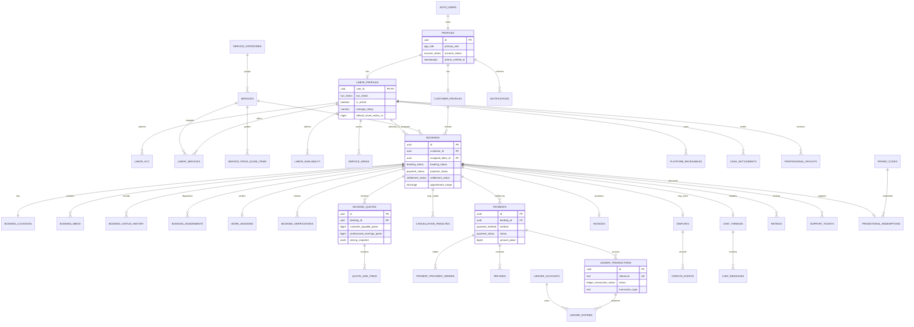

# CivilConnect database ER diagram

The diagram shows the principal relationships. Supporting tables such as audit, notification, provider-event, and reconciliation records attach to the relevant aggregate but are omitted from some edges for readability.

## Aggregate boundaries

- **Identity:** `profiles`, customer/professional profiles, KYC, admin roles, devices.
- **Catalog:** categories, services, price guides, effective-dated pricing, labor mappings and availability.
- **Booking:** booking, location snapshot, media, dispatch attempts, state history, work verification, quote versions.
- **Money:** payments/provider events, refunds, immutable pricing snapshot, ledger journals/entries, receivables, settlements, payouts, reconciliation.
- **Experience:** ratings, notifications, chat, disputes, tickets, promotions, saved addresses/professionals.
- **Governance:** audit logs, configuration, consents, deletion, policy versions, SOS.

The database uses `profiles.id` as the canonical identity key and does not duplicate authentication records in customer or professional tables.
