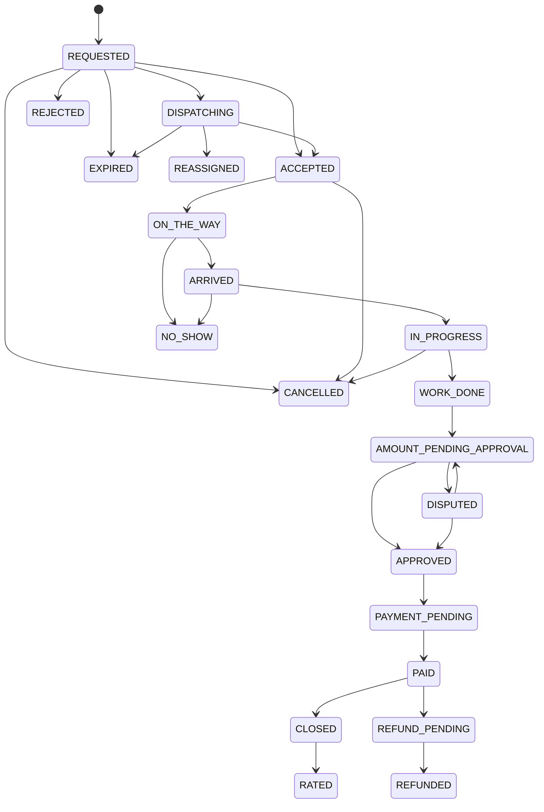

# State machines and invariants

## Booking status



`transition_booking_status()` is the only intended client-facing transition function. A trigger rejects direct status updates that do not set its transaction-local authorization marker. Each accepted transition records the previous state, next state, actor, reason, metadata, and server timestamp in `booking_status_history` and `audit_logs`.

## Separate payment state

`payments.status` is independent from `bookings.booking_status`:

```text
PENDING -> ORDER_CREATED -> AUTHORIZED -> CAPTURED
PENDING -> FAILED
CAPTURED -> PARTIALLY_REFUNDED -> REFUNDED
CAPTURED -> DISPUTED
```

The client callback does not change this state. The trusted payment Edge Function must verify the Razorpay signature and provider/webhook status before posting the payment and its ledger journal.

## Separate settlement state

`bookings.settlement_status` and the settlement tables represent platform dues and payouts:

```text
NOT_STARTED -> PENDING -> PARTIALLY_SETTLED -> SETTLED
PENDING -> FAILED
SETTLED -> REVERSED
```

The initial cash limit is calculated from outstanding `platform_receivables` for the professional, not from gross physical cash. The default threshold is 500,000 paise (₹5,000), with a warning at 80%. Verified settlements reduce receivables only through an idempotent backend operation.

## Ledger invariant

Every posted `ledger_transactions` journal must satisfy:

```text
sum(debit entries) = sum(credit entries) > 0
```

`post_ledger_transaction()` locks the journal, verifies this invariant, and changes `draft` to `posted`. Posted entries are append-only; correction uses reversal or audited adjustment journals.

## Scheduling invariant

`bookings.appointment_range` is a stored `tstzrange`. A GiST exclusion constraint prevents overlapping active ranges for the same `assigned_labor_id`. A partial unique index prevents more than one active `work_sessions` row per professional.
