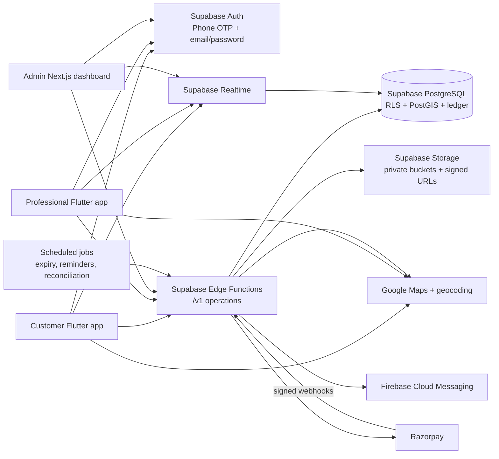

# CivilConnect — Phase 1 Architecture and Decisions

**Status:** Phase 1 complete; awaiting explicit `CONTINUE` before Phase 2 implementation.

## 1. Product summary

CivilConnect is an India-focused, on-demand home-services marketplace connecting customers with verified service professionals. The product has three role-based experiences:

1. **Customer mobile app** — discover a service, describe the job, share GPS location, select a professional or automatic matching, track work, approve a final quote, pay, dispute, rate, and manage support.
2. **Professional mobile app** — onboard and complete KYC, configure availability, accept jobs, navigate, verify arrival and work start, submit an itemized final quote, collect/settle money, and manage earnings.
3. **Admin web dashboard** — manage users, KYC, services, pricing, bookings, disputes, ledger activity, settlements, payouts, promotions, policies, reports, and audit records.

The authoritative backend is Supabase. The Flutter client is never trusted for authorization, pricing, payment success, state transitions, or financial posting.

## 2. Proposed system architecture



### Why Supabase is primary

- **PostgreSQL** provides transactions, row-level locking, exclusion constraints for scheduled work, append-only accounting, and mature indexing.
- **RLS** lets access rules live close to the data. Edge Functions handle privileged transitions while exposed tables remain protected if a client is compromised.
- **Auth** supports the required phone OTP and email/password flows without creating a second identity system.
- **Realtime** is appropriate for booking state, assignment, quote, chat, and settlement updates. It is a delivery mechanism only; the database remains the source of truth.
- **Storage** supports private job photos and KYC documents through signed access, without placing sensitive files in public buckets.
- **Edge Functions** keep Razorpay secrets, webhook verification, pricing, dispatch, ledger posting, and administrative actions server-side.

No separate NestJS/Express service is planned. A separate queue or Redis is not required for the initial design; scheduled Supabase jobs plus transactional database functions cover expiry, reminders, reconciliation, and retries. This can be revisited when measured workload requires it.

## 3. Component responsibilities

### Flutter mobile applications

The initial Flutter project will be structured as shared domain/data code with role-specific feature modules:

```text
lib/
  app/                 theme, routing, dependency wiring
  core/                errors, validation, money, location, permissions
  data/                Supabase clients, repositories, DTOs, realtime
  features/
    auth/
    customer/          discovery, booking, tracking, quote, payment, support
    professional/      onboarding, jobs, quote, earnings, settlements
    shared/             notifications, chat, profile, settings
```

Riverpod owns UI state and repository lifetimes. GoRouter supplies role-aware navigation, but route guards are UX only; all authorization is enforced by Supabase Auth, RLS, and Edge Functions.

### Admin dashboard

The requested admin dashboard is a separate responsive Next.js/Tailwind application. It uses the same versioned Edge Function API and never receives service-role credentials in the browser. Admin permissions are derived from database role assignments and checked server-side for every privileged operation.

### Edge Functions

Edge Functions expose authenticated `/v1` operations for:

- profile and professional onboarding/KYC;
- service discovery, eligibility, and availability;
- booking creation, dispatch, assignment, and state transitions;
- arrival/work verification and quote submission/approval/dispute;
- pricing snapshots and payment-order creation;
- Razorpay signature/webhook processing;
- cash collection, settlement, payout, and reconciliation;
- admin actions, adjustments, reports, and audit logging.

Every mutating operation will validate input, verify the caller and role, accept an idempotency key where retries are possible, perform the state change transactionally, and emit an audit/event record.

### PostgreSQL

PostgreSQL is the source of truth for identities, service configuration, eligibility, availability, booking state, quotes, payment state, settlement state, journal entries, support, notifications, and audit history. Money will be stored as integer paise (`bigint`); rates will use a precise numeric representation and effective-dated configuration snapshots.

PostGIS will support nearby-professional searches. Timestamp ranges and exclusion constraints will protect confirmed appointments. Database functions will own high-risk transitions such as accepting a job, approving a quote, posting a payment, recording cash, and verifying a settlement.

## 4. Primary data flows

### Customer booking

1. Customer authenticates and completes required phone verification.
2. App loads service categories and price guidance from authorized read APIs.
3. Customer submits description/media and the app obtains device GPS coordinates. A reverse-geocoded display address is stored only as a snapshot; coordinates remain authoritative.
4. Customer chooses a professional or “Pick for me”, then an immediate or future time.
5. Edge Function validates server time, lead time, eligibility, availability, location, and policy. It creates the booking and dispatch attempt in one transaction. No booking fee is collected.
6. Assignment and booking changes are persisted, published through Realtime, and delivered through FCM where configured.

### Professional job and quote

1. An approved, eligible professional receives a request with approximate location and accepts/rejects within the configured timeout.
2. Acceptance locks the relevant schedule and reveals exact customer details only to the authorized participant.
3. Professional marks on-the-way, arrives using server-checked location signals, receives a customer-issued start OTP, and starts work.
4. Professional submits labor, material, visiting, and approved add-on items. The backend calculates totals, tax, commission, fixed fee, and earnings.
5. Customer explicitly approves or disputes. An approved quote becomes an immutable pricing snapshot. Disputes create a support workflow and pause payment.

### Payment and settlement

1. For online payment, the backend creates the Razorpay order using the frozen payable amount. The client only launches Checkout and submits provider identifiers.
2. The backend verifies the Razorpay signature and signed webhook/provider status before posting payment and ledger entries. Client callbacks never mark payment successful.
3. For cash, the professional records a verified collection after customer approval. The ledger records gross physical cash separately from the professional’s earnings and platform receivable.
4. Settlement deposits and payouts are verified through provider records and idempotent transactions. Failed or duplicate events preserve history and do not duplicate balances.

## 5. Financial architecture

The following balances must remain separate and must not be calculated by adding incompatible figures:

| Measure | Meaning | Initial accounting treatment |
|---|---|---|
| Gross cash collected | Physical customer cash received by a professional | Booking/payment event; not the professional’s income or the platform’s revenue by itself |
| Service earnings | Professional’s share of the approved service quote after applicable commission | Payable to the professional after the relevant payment/collection event |
| Platform commission | Percentage revenue owed by the professional, subject to configured caps and snapshot rules | Platform revenue plus professional platform receivable where applicable |
| Fixed platform fee | Disclosed customer-facing fee | Platform revenue, with taxes handled according to the effective policy |
| Outstanding platform dues | Unpaid commission and fixed fees owed to the platform from cash bookings | Threshold measure for the initial ₹5,000 cash-exposure rule |
| Online payable balance | Verified professional earnings from online bookings, less approved adjustments/payouts | Potentially withdrawable only after eligibility rules |
| Withdrawable balance | Online payable funds eligible for payout after holds, disputes, KYC, reserves, and policy checks | Derived from posted ledger state, never from a client-side wallet |
| Verified settlement | A provider-verified deposit that reduces platform receivables | Posted only after verification; partial and failed settlements remain explicit |

The ledger will be double-entry and append-only after posting. Corrections use reversals or authorized adjustments with mandatory reasons. Every journal has a unique reference, source booking/payment, transaction type, currency, timestamps, and audit metadata. A database constraint/function will reject unbalanced journals.

The initial cash rule applies the default configurable ₹5,000 threshold to **outstanding platform obligations from cash bookings**, as confirmed in the specification. Gross physical cash is reported separately. The design leaves a separate physical-cash limit configurable if the business later chooses to activate it.

## 6. Confirmed requirements vs proposed defaults

### Confirmed by `project.md`

- Flutter Android/iOS apps, Supabase PostgreSQL/Auth/Realtime/Storage/Edge Functions, FCM, Razorpay.
- Phone OTP and email/password authentication.
- Customer-selected and automatic professional matching.
- Professional-generated final quote after work; explicit approval/dispute before payment.
- Percentage commission plus fixed platform fee.
- Cash collection with a default configurable ₹5,000 outstanding-obligation threshold.
- No upfront booking charge; minimum 30-minute lead time using server time.
- Backend-controlled state machines, RLS, immutable pricing snapshots, append-only balanced ledger, idempotent payment/webhook handling.
- Customer, professional, and admin interfaces with the feature areas listed in the specification.

### Proposed defaults for implementation, pending business confirmation

- Default currency: INR; all money in integer paise.
- Initial dispatch: sequential ranked dispatch, with a configurable broadcast strategy added to the same dispatch model.
- Initial assignment response timeout: 120 seconds, configurable.
- Initial quote-dispute escalation: 15 minutes, configurable as stated in the specification.
- Initial cash warning: 80% of the configured outstanding-obligation threshold.
- Initial quote revision cap: 2 revisions, configurable.
- Initial location updates: only after “on the way”, with a battery-conscious interval and server-side participant authorization.
- Initial database shape: one canonical `profiles` record per Auth user, one optional customer profile, one optional professional profile, and separate admin role assignments.
- Initial MVP deployment environments: local/development, staging, production, each with separate Supabase projects and secrets.

These defaults are implementation parameters, not hard-coded business truths; they will be stored in effective-dated configuration tables.

## 7. Unresolved decisions that materially affect implementation

These need confirmation before the affected database/payment/legal modules are finalized:

1. **Razorpay marketplace flow:** Should production payouts use Razorpay Route, another supported arrangement, or platform-managed bank/UPI settlements? Account eligibility, onboarding, KYC, fund flow, and provider fees must be confirmed with Razorpay.
2. **Tax policy:** Who is the tax invoice issuer, which charges are taxable, how are materials treated, and what GST/TDS rules apply? A qualified Indian tax professional must confirm rates and invoice treatment before production configuration.
3. **Professional onboarding/KYC:** Which identity documents, background-check vendor, retention period, and manual-review SLA are required?
4. **Cancellation/no-show policy:** Exact penalties, grace/waiting periods, strike thresholds, and whether customer dues can restrict future bookings.
5. **Payment method policy:** Whether cash is allowed for every service/category, whether online payment is required above a threshold, and how cash overpayments/refunds are handled.
6. **Service geography:** Initial launch city/cities, service radius defaults, GPS accuracy tolerance, and whether background location is required.
7. **Support operations:** Admin roles, escalation SLAs, emergency/SOS response ownership, and masked calling provider.
8. **Data retention and deletion:** Retention periods for KYC, invoices, chat, location traces, audit logs, and legally required records.
9. **Promotions and referrals:** Budget ownership, eligibility, stacking rules, expiry, refund treatment, and ledger treatment.
10. **Payout eligibility:** Settlement hold period, minimum payout, reserve/chargeback hold, payout schedule, and professional-specific restrictions.

Until confirmed, production code must expose configuration and safe failure states rather than guessing a legal, tax, payout, or enforcement rule.

## 8. Risk register

| Risk | Impact | Mitigation |
|---|---|---|
| Client tampers with amount or role | Unauthorized charge or privilege escalation | Server-derived pricing, Edge Function authorization, RLS, no client financial authority |
| Duplicate Razorpay webhook/retry | Duplicate payment or ledger posting | Raw-body signature verification, event-id uniqueness, idempotent transaction references |
| Concurrent acceptance/cash collection | Double booking or incorrect exposure | Row locks, serializable/transactional operations, exclusion constraints, concurrency tests |
| Quote dispute or silent alteration | Customer harm and financial inconsistency | Immutable approved snapshot, explicit dispute state, revision cap, admin audit decision |
| KYC/privacy exposure | Identity theft and regulatory harm | Private storage, signed URLs, least-privilege admin policies, retention/deletion workflow |
| Location spoofing or inaccurate GPS | Unsafe arrival/start verification | Accuracy and mock-location signals as fraud inputs, OTP, support review; never treat GPS as infallible |
| Cash receivable accumulation | Platform credit risk | Atomic threshold check, 80% warning, configurable restriction, verified settlements, reconciliation |
| Payment provider mismatch | Failed production fund flow | Confirm Razorpay marketplace capability before enabling payouts; keep provider state separate |
| Tax/legal misconfiguration | Compliance and invoice exposure | Effective-dated config, qualified Indian legal/tax review, no hardcoded unverified rates |
| Notifications delayed/offline | Missed assignment or stale UI | Persist notifications, Realtime refresh on reconnect, FCM retry/fallback, backend as source of truth |
| Schedule overruns | Customer disruption and double booking | Range-based reservations, travel/buffer configuration, explicit rescheduling and notifications |
| Fraudulent reviews/cancellations | Ranking and marketplace quality degradation | One review per eligible booking, moderation, anomaly signals, audit history |
| Operational scale/performance | Slow discovery and unreliable dispatch | PostGIS/indexes, measured p95 targets, background jobs, load/concurrency testing |

## 9. Smallest production-ready MVP

The MVP preserves the mandatory safeguards while limiting operational breadth:

### Customer

- Phone OTP/email authentication and profile.
- Service discovery for a controlled launch catalog.
- Text/photo problem description and GPS-derived location.
- Choose a professional or sequential automatic matching.
- Immediate and scheduled bookings with server-enforced 30-minute lead time.
- Booking tracking through accepted/on-the-way/arrived/in-progress/work-done.
- Itemized quote approval/dispute.
- Online Razorpay payment after approval and cash collection flow.
- Booking history, receipts, notifications, support ticket, and rating.

### Professional

- Registration, service selection, availability, online toggle, and KYC submission/review.
- Job request accept/reject, protected customer details, navigation, arrival/start OTP.
- Itemized quote with photos.
- Cash collection confirmation, dues/earnings view, verified settlement request.

### Admin

- Role-protected professional/KYC approval.
- Service, pricing, fee, commission, tax-policy, and cash-threshold configuration.
- Booking/dispute/support monitoring.
- Ledger, cash receivable, settlement, payout, reconciliation, and audit views.

### Required platform foundation

- Full RLS and server-side authorization.
- Explicit booking/payment/settlement state machines.
- Immutable pricing snapshots and balanced append-only ledger.
- Idempotent Razorpay webhook handling.
- Private media/KYC storage.
- Persisted notifications and audit logs.
- Critical unit, integration, RLS, and concurrency tests.

Maps navigation, FCM, masked calling, promotions, advanced reporting, background checks, automated payouts, and broad multi-city operations can be enabled incrementally, but the underlying authorization and financial model should be established in the MVP schema.

## 10. Phase 1 completion checklist

- [x] Architecture diagram and technology responsibilities.
- [x] Customer, professional, and admin application structure.
- [x] Financial definitions and cash-limit interpretation.
- [x] Confirmed requirements, proposed defaults, and unresolved decisions.
- [x] Risk register and smallest practical production-ready MVP.
- [ ] Phase 2 SQL migrations, RLS, indexes, functions, and state-machine constraints — starts after explicit `CONTINUE`.
